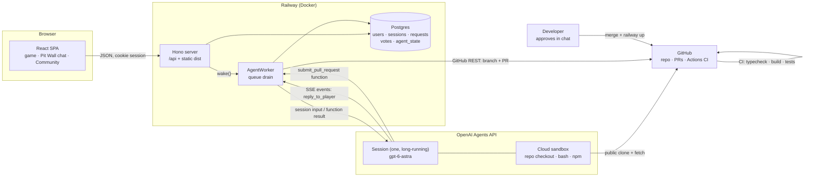

# Pitwall

**Players describe the change they want. An AI agent builds it. The developer approves it in one message.**

Feedback today is a one-way street. Players file a suggestion and it disappears into a backlog. Developers get a stream of vague requests they don't have time to triage, reproduce, scope and build. Pitwall closes that gap. Every suggestion becomes a **tested pull request with a plain-language summary**, other players **vote** on which ones matter most, and the developer only decides: approve or not.

The product in this repo is a turn-based Formula 1 board game. It's the test bed: a real app with real rules, real balance problems and real players. Pitwall is everything around it.

**Live:** https://game-production-ab90.up.railway.app

---

## The loop

```
 Player                    Pit Wall agent                     Community            Developer
 ──────                    ──────────────                     ─────────            ─────────
 "The first player    ──▶  reads the code, runs the      ──▶  idea + agent's  ──▶  reads a summary
  wins too often"          3,000-race simulation,             reply shown,         (what, effect,
                           finds P1 wins 50%,                 players vote         risk, checks),
                           changes the start rule,                                 says "approve"
                           re-runs tests: 26%,                                         │
                           opens PR #9                                                 ▼
 sees "Live in the  ◀──────────────────────────────────────────────────────── merge + deploy
 game" on next visit
```

1. **Suggest.** A signed-in player writes a request in the in-game *Pit Wall* chat (5 a day, 10–2000 characters). It goes into a queue, and the player doesn't wait.
2. **Build.** One long-running agent picks up requests one at a time. It decides whether the request belongs in the product. If it does, it makes the smallest change that does the job, proves it with tests and the balance simulation, and opens a PR. Off-topic, unfair or unsafe requests are declined with a friendly reason.
3. **Vote.** Every idea with an open PR appears on the *Community* page under the player's name, sorted by votes. The developer reviews the most-wanted ideas first.
4. **Approve.** The developer reads the PR summary, not the diff, and approves. The change is merged, deployed, and marked *Live in the game*.

### It works: shipped so far

All three came from players, were built by the agent, and went live after one approval each.

| Player request | What the agent did | PR |
| --- | --- | --- |
| "The Safety Car comes out too often when I try to overtake" | Safety Car chance on an overtake 35% → 25%, balance re-checked | [#4](https://github.com/shuaiqideboa/pitwall/pull/4) |
| "We should have a home page, so users can log in" | New home screen with sign-in and the Pit Wall; race screen shows only the race | [#6](https://github.com/shuaiqideboa/pitwall/pull/6) |
| "Players should roll the dice together, otherwise the first player has too much advantage" | Measured it (seat 1 won 50%, seat 4 won 11%), tried four fixes, shipped the one that brought every seat to 24–26%, added a fairness test that fails on the old rules | [#9](https://github.com/shuaiqideboa/pitwall/pull/9) |

PR #9 shows the point. A player's hunch became a measured diagnosis, a rejected-alternatives write-up and a regression test. That's more rigour than most human-filed tickets get.

---

## Architecture



### Request lifecycle

```
queued ──▶ working ──▶ pr_open ──▶ merged     (shown on Community, then "Live in the game")
                  │            └─▶ rejected
                  ├──▶ answered                (no change needed)
                  ├──▶ declined                (out of scope / unfair / unsafe)
                  └──▶ failed                  (error or 45-min deadline; player told to resend)
```

### Agent worker (`server/agent/worker.ts`)

- **Independent request screening.** Before the coding session is read or created, a fresh, tool-free GPT-6 Astra Responses call checks Pitwall scope, equal treatment and basic race rules. Unrelated work, guaranteed wins, rigged dice, identity-based advantages and rule bypasses receive a fixed refusal. A review error never starts the coding agent. These review calls are separate API usage from the managed session.
- **One agent, one session, for every player.** The session id is stored in `agent_state` under `openai_session_id`, separate from the previous Claude session. Only a confirmed deleted session (HTTP 404) is recreated automatically. Authentication, network and failed-session errors never silently allocate another billed session. A single agent sees every request, so it can spot duplicates and fold related ideas together without coordinating several agents.
- **Async queue in Postgres.** `wake()` is idempotent and is called on every new request. `drain()` claims the oldest `queued` row atomically (`UPDATE … WHERE id = (SELECT … LIMIT 1) RETURNING`) and hands it to the session as input. On boot, `recover()` puts `working` rows back in the queue. Run one game server replica: the shared agent session needs a single input writer.
- **Stream first, then send.** The OpenAI SDK subscribes before sending input and follows the root turn until it finishes and the session is idle. A 45-minute deadline also covers a stalled stream. Closing SSE alone does not stop remote execution, so errors trigger explicit cancellation. After a restart, an interrupted remote turn is cancelled before the requeued request is retried. The prompt checks for an existing request PR and preserves branch work to avoid duplicate PRs. Server publishing reuses existing PRs and never force-updates a branch.
- **Structured outcome via a custom tool.** The agent must finish each request by calling `reply_to_player({request_id, status, message, pr_url})`. The server validates it before storing:
  - the id must be the current request;
  - the status must be `pr_open`, `answered` or `declined`;
  - the message must be 1–1000 characters;
  - for `pr_open`, the PR URL must match `github.com/<owner>/<repo>/pull/<n>`.

  If validation fails, the problem goes back to the agent as the tool result so it can correct itself. A turn that never replies is marked `failed`.
- **Unattended operation.** Function calls are handled by the worker; any other interactive action fails the request and triggers cancellation.
- **Test backend.** Without an OpenAI agent ID in local dev or CI, `testBackend` acknowledges requests. Production requires the OpenAI key, agent ID and server-side GitHub token, and fails startup if any are missing.

### Agent definition (`server/agent/definition.ts`, `prompt.ts`)

The agent and its sandbox are defined in code as typed OpenAI SDK params. `npm run agent:setup` creates the saved agent, or updates the supplied agent ID. It never reads or uploads GitHub credentials. Sessions copy the saved agent configuration when created; updating the saved agent does not alter an existing session.

| Concern | Setting |
| --- | --- |
| Model | `gpt-6-astra`, effort `high` |
| Tools | OpenAI-hosted shell and files; web search disabled; `get_request_pull_request`, `submit_pull_request` and `reply_to_player` functions; multi-agent execution disabled |
| GitHub | Railway owns the token and calls GitHub REST directly. The model can request a PR only for the current player request, in the configured repo. No merge, force-push, settings or arbitrary API tool |
| Repo | Public checkout at `/workspace/pitwall`, without credentials. The model submits full UTF-8 file contents; Railway creates Git trees, a commit, a request branch and the PR |
| Network | Sandbox restricted to `github.com`, `api.github.com` and `registry.npmjs.org` |
| Spend | Optional per-session USD-cent cap (`PITWALL_SESSION_BUDGET_CENTS`); an exhausted or failed session is not automatically replaced |

The sandbox receives no GitHub token, vault or authenticated MCP connection. `server/agent/github.ts` validates request ownership, paths, duplicate files, payload size and the tested base SHA before publishing. Only UTF-8 files under `src/` and `public/` are accepted, excluding account code; dependency manifests, server code and CI are blocked. Maximum 30 files and 1 MiB per submission. If main moved, the agent must fetch and retest. GitHub CI and human review still gate merging. This checkout setup currently requires a public repository.

Before any GitHub write, the server also sends the actual base file contents and proposed contents to an independent scope/fairness review, without tools or the coding agent's conversation. A rejection, incomplete response or API error blocks publication. Review input is capped at 512 KiB including both versions; larger changes must be split. The original `src/game/engine.test.ts`, `balance.test.ts` and `config.test.ts` cannot be edited or deleted through the publishing tool. New regression tests can be added in separate files.

These checks are defense in depth, not a proof that every adversarial request or unfair code change will be detected. Deterministic path restrictions, the protected rule tests, 3,000-race balance simulation, required GitHub CI and human merge approval remain necessary.

Run `npm run agent:policy-eval` with `OPENAI_API_KEY` to repeat the live ten-case scope/fairness evaluation. It includes guaranteed wins, owner impersonation, unrelated tasks, core-rule removal, a hidden cheating code change, and legitimate requests. This explicitly billed check is separate from the offline test suite and makes no repository writes.

Budget compatibility: the current project returned HTTP 400 for `spend_control` during the migration smoke test (2026-11-11), despite its presence in the SDK/API reference. Leaving `PITWALL_SESSION_BUDGET_CENTS` unset sends no session cap. If a cap is configured and the API rejects it, the worker fails the request and never retries without the cap. The 45-minute deadline is a time limit, not a dollar limit.

**The system prompt is the product policy.** It defines:
- **Scope:** Pitwall only. It declines unrelated work, pay-to-win changes, and anything touching accounts, secrets, CI or deployment.
- **Process:** work from `origin/main`, make the smallest change (prefer `config.ts` within `CONFIG_RULES`), `npm test` + `npm run build` must pass, then submit file contents to the server, which creates `pitwall/request-<id>` and opens the PR. Never touch `.github/`, `server/`, dependencies or account code.
- **PR format for a busy developer:** *Requested by · What changed · Effect (before/after numbers) · Risk · Checks · Recommendation*.

**Prompt injection:** player text is wrapped in a `<player_request>` block. Closing tags are stripped, and the system prompt treats the text as data describing a wish, never as instructions.

### Guardrails that make AI changes safe to approve

The agent can only propose changes. Each layer below limits what it can break:

1. **Allowed ranges for every setting.** Every tunable number (tyre dice, wear, pit limiter, overtake odds, Safety Car, pacing, camera) lives in `src/game/config.ts`. `CONFIG_RULES` gives each one an allowed range, `validateConfig()` rejects anything outside it, and a test enforces this.
2. **Balance simulation as a regression test.** `src/game/balance.test.ts` plays 3,000 seeded races (mulberry32) with random tyre plans and overtaking styles. It fails if:
   - a race doesn't finish;
   - one strategy dominates;
   - overtaking stops paying off;
   - a seat wins outside 15–35%.

   The agent uses the same simulation to measure the effect it reports in the PR.
3. **CI on every PR** (GitHub Actions): `npm ci`, `tsc -b`, `vite build`, the server bundle, and the full test suite.
4. **Protected `main`.** A PR and a green `build` check are required, enforced for admins too. No force-push, no deletion.
5. **A human approval and a manual deploy.** Nothing reaches players until the developer approves.

### Server (`server/`)

- **Hono** on `@hono/node-server`. One process serves the built SPA and `/api`. SPA fallback for page routes, JSON 404 for unknown `/api/*`.
- **Postgres via `pg`** in production. **PGlite** (embedded Postgres, WASM) locally and in tests, running the same SQL and migrations, so tests hit a real Postgres engine with no Docker.
- **Auth:**
  - scrypt password hashes;
  - random session tokens stored as SHA-256 hashes;
  - `HttpOnly; Secure; SameSite=Lax` cookies;
  - JSON-only POSTs (CSRF-resistant);
  - 16 KB body limit;
  - login rate limiting.
- **Community API:**
  - `GET /api/community` returns ideas waiting for review (`pr_open`, sorted by votes) and recently shipped ones (`merged`). Each idea includes the player's display name, vote count, whether you voted, and whether it's yours. Emails and PR URLs are never exposed.
  - `POST /api/community/:id/vote {vote: boolean}` is idempotent (`ON CONFLICT DO NOTHING`, composite primary key `(request_id, user_id)`). You can't vote on your own idea, or on one that isn't open for review.

| Endpoint | Purpose |
| --- | --- |
| `POST /api/signup` · `/api/login` · `/api/logout` · `GET /api/me` | Accounts |
| `POST /api/requests` · `GET /api/requests` | Submit a request, read your requests and the agent's replies |
| `GET /api/community` · `POST /api/community/:id/vote` | Community board and voting |

### Frontend (`src/`)

React 18 + TypeScript + Vite. The game engine (`src/game/engine.ts`) is a pure, deterministic state machine (`GameState → GameState`), which is what makes the 3,000-race simulation and the rule tests possible. Rendering: an SVG track built from Catmull-Rom splines, a follow camera with rAF smoothing, a 3D CSS die, and synthesized Web Audio cues.

### Product film

The home page's **Watch the film** entry opens *The next lap*, a 48-second English introduction. It follows player feedback through AI implementation, community voting, human approval and deployment, ending with the measured fairness improvement from [PR #9](https://github.com/shuaiqideboa/pitwall/pull/9).

- `src/film/script.ts` is the shared chapter/caption timeline; `renderer.ts` generates the circuit, cars, floating UI and all typography in one Three.js canvas. Subtitles follow the measured narration timings in `narration-timing.ts`.
- English AI narration uses seven static Cedar voice clips under `public/film/narration/`. Each clip speaks exactly its caption and starts 0.65 seconds after its chapter begins. The browser makes no speech-generation API calls.
- `heroic-score.ts` composes an original orchestral-action score with a brass fanfare, articulated strings and cinematic percussion. `soundtrack.ts` mixes narration and music into one deterministic stereo buffer, lowering music under speech and bringing it back between lines. This is an original composition, not a licensed film soundtrack.
- The player opens on a still frame with sound enabled. **Play** waits for the complete mix and uses the audio sample clock for the pictures, captions, pause and seeking. Chapter jumps start before the narrator's first word. It also supports fullscreen, mute and a transcript; Three.js loads only when the film opens.
- **Save film** records a 1280×720, 30 fps video with narration and music, preferring H.264/AAC MP4 and falling back to WebM on compatible browsers. Export runs for 48 seconds; keep the tab visible. Muting preview speakers does not mute the exported mix. Closing or cancelling releases recording resources.
- Local video exports and browser QA captures belong in ignored `output/film/` and `output/playwright/`. The home thumbnail is `public/film/pitwall-poster.jpg`, captured from the rendered film.

To regenerate the voice assets manually, use the environment's `OPENAI_API_KEY` with `node --import tsx scripts/generate-film-narration.ts`, then run `python3 scripts/prepare-film-narration.py`. The second command repairs streaming WAV headers, trims only outer silence, normalizes speech levels, validates chapter fit and writes the measured cue table. Generation is an explicit development step with API usage; credentials never enter the client bundle. The current recorded assets were generated with `gpt-4o-mini-tts`/`cedar`; the generator's model may need updating after that API's retirement. Normal playback and video exports use only the checked-in audio files.

---

## The test-bed game

4 players, 5 laps at Albert Park, one die per turn.

- **Lights out:** once everyone has picked starting tyres, each player in turn rolls their start die (nobody moves yet). After the last roll the lights go out and the whole field gets away together; the slowest starter moves first.
- **Tyres:** Soft, Medium and Hard each have their own die. Softs and Mediums wear out. Every car must pit at least once.
- **Pit lane:** call BOX, crawl through under the limiter, change tyres at your box.
- **Overtaking:** catch the car ahead and choose to overtake or stay behind. A pass may bring out the Safety Car (25%, 9% in a DRS zone) or a red flag (2%). Nobody is ever knocked out.
- **Lapped cars** let you through (blue flags). There's no overtaking under the Safety Car.

---

## Run it locally

```bash
npm install
npm run dev          # game with live reload, http://localhost:5173
npm run dev:server   # API on :8787 (second terminal), embedded Postgres in .data/
npm test             # rules, API, worker, community, 3,000-race balance simulation
```

Build the same bundles as the Docker image:

```bash
npm run build
npm start   # production: requires OpenAI configuration below; uses DATABASE_URL when set
```

In local development, without an OpenAI agent ID, Pit Wall runs in **test mode**: requests are acknowledged but not built. Production never falls back to test mode. To run the real agent:

| Variable | What |
| --- | --- |
| `OPENAI_API_KEY` | OpenAI project key with Agents API, hosted-environment and `gpt-6-astra` access |
| `PITWALL_OPENAI_AGENT_ID` | Printed by `npm run agent:setup`; required at runtime |
| `PITWALL_GITHUB_TOKEN` | Runtime only, held by Railway: fine-grained token with contents + pull requests write on this repo. Sent directly to GitHub, never to OpenAI |
| `PITWALL_REPO_URL` | Defaults to this repo |
| `PITWALL_SESSION_BUDGET_CENTS` | Optional spend cap per session |
| `DATABASE_URL` | Postgres; omit to use embedded PGlite |

### Provision and deploy

1. Supply `OPENAI_API_KEY` through your secret manager and run `npm run agent:setup`. No GitHub token or model turn is involved. On subsequent setup runs, supply the printed agent ID to update that resource.
2. Set `OPENAI_API_KEY` and `PITWALL_OPENAI_AGENT_ID` on Railway's `game` service in `production`, and retain its existing `PITWALL_GITHUB_TOKEN`. Optionally set the session budget before the first request, subject to the API compatibility note above.
3. Run `npm test` and `npm run build`. Deploy the reviewed commit using the existing Dockerfile and Railway CLI, then verify startup logs identify `OpenAI Agents API, gpt-6-astra` and send an end-to-end request to check the reply/PR flow.

Claude conversation history is not imported. The old `agent_state.session_id` and previous Claude environment variables are not read by the new backend. Preserve them until rollout is verified so the previous Docker deployment can be restored if necessary. Before switching, let the Claude queue finish and confirm its remote session is idle; deploying a new worker does not cancel work already running at Anthropic.

Existing sessions can update model/reasoning settings, but changing instructions requires a new session. For a prompt rollout, first wait for an empty queue and idle session, preserve the old ID for rollback, then create a session from the updated saved agent. Do not clear `openai_session_id` merely to work around a spending limit or transient error. The server-side request and code policy checks apply immediately to existing sessions after deployment. See [session configuration](https://developers.openai.com/api/docs/guides/agents-api/configuration) and [function tools](https://developers.openai.com/api/docs/guides/agents-api/tools/functions).

## Repository map

| Path | What |
| --- | --- |
| `server/agent/prompt.ts` | The agent's system prompt (product policy) and the `reply_to_player` tool |
| `server/agent/definition.ts` | Agent + sandbox definition (model, function tools, network) |
| `server/agent/setup.ts` | `npm run agent:setup`: create or update the agent |
| `server/agent/worker.ts` | Queue, session streaming, reply validation, test backend |
| `server/agent/github.ts` | Server-side GitHub authentication and validated PR publishing |
| `server/agent/policy.ts` | Independent Pitwall scope/fairness screening for requests and proposed code |
| `server/app.ts` | HTTP API: accounts, requests, community, votes |
| `server/db.ts` | Postgres / PGlite connection and migrations |
| `src/game/config.ts` | Every tunable number and its allowed range |
| `src/game/engine.ts` | Game rules as a pure state machine |
| `src/game/balance.test.ts` | 3,000-race balance simulation |
| `src/components/PitWallChat.tsx` | In-game request chat |
| `src/components/Community.tsx` | Community board and voting |
| `Dockerfile` | Two-stage build used by Railway |

## What's next

- **Preview deploys per PR**, so players can try an idea before voting on it.
- **Context management** for the single long-running session as the request history grows.
- **Grouping similar ideas** so their votes add up.
- **Pitwall as a drop-in**: the chat, queue, agent and community don't depend on the game, so the next step is pointing them at another repo.

## Built with

[OpenAI Agents API](https://developers.openai.com/api/docs/guides/agents-api) (GPT-6 Astra) · TypeScript · React · Vite · Hono · Postgres / PGlite · Vitest · GitHub Actions · Railway · Docker. Originally built with Claude Code.
