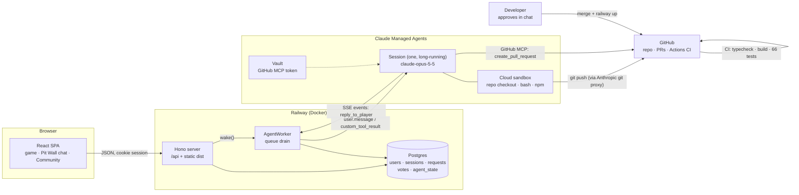

# Pitwall

**Players describe the change they want. An AI agent builds it. The developer approves it in one message.**

Feedback today is a one-way street. Players file a suggestion and it disappears into a backlog. Developers get a stream of vague requests they don't have time to triage, reproduce, scope and build. Pitwall closes that gap. Every suggestion becomes a **tested pull request with a plain-language summary**, other players **vote** on which ones matter most, and the developer only decides: approve or not.

The product in this repo is a turn-based Formula 1 board game. It's the test bed: a real app with real rules, real balance problems and real players. Pitwall is everything around it.

**Live:** https://game-production-ab90.up.railway.app

---

## The loop

```
 Player                    Pit Wall agent                     Community            Developer
 ──────                    ──────────────                     ─────────            ─────────
 "The first player    ──▶  reads the code, runs the      ──▶  idea + agent's  ──▶  reads a summary
  wins too often"          3,000-race simulation,             reply shown,         (what, effect,
                           finds P1 wins 50%,                 players vote         risk, checks),
                           changes the start rule,                                 says "approve"
                           re-runs tests: 26%,                                         │
                           opens PR #9                                                 ▼
 sees "Live in the  ◀──────────────────────────────────────────────────────── merge + deploy
 game" on next visit
```

1. **Suggest.** A signed-in player writes a request in the in-game *Pit Wall* chat (5 a day, 10–2000 characters). It goes into a queue, and the player doesn't wait.
2. **Build.** One long-running agent picks up requests one at a time. It decides whether the request belongs in the product. If it does, it makes the smallest change that does the job, proves it with tests and the balance simulation, and opens a PR. Off-topic, unfair or unsafe requests are declined with a friendly reason.
3. **Vote.** Every idea with an open PR appears on the *Community* page under the player's name, sorted by votes. The developer reviews the most-wanted ideas first.
4. **Approve.** The developer reads the PR summary, not the diff, and approves. The change is merged, deployed, and marked *Live in the game*.

### It works: shipped so far

All three came from players, were built by the agent, and went live after one approval each.

| Player request | What the agent did | PR |
| --- | --- | --- |
| "The Safety Car comes out too often when I try to overtake" | Safety Car chance on an overtake 35% → 25%, balance re-checked | [#4](https://github.com/shuaiqideboa/pitwall/pull/4) |
| "We should have a home page, so users can log in" | New home screen with sign-in and the Pit Wall; race screen shows only the race | [#6](https://github.com/shuaiqideboa/pitwall/pull/6) |
| "Players should roll the dice together, otherwise the first player has too much advantage" | Measured it (seat 1 won 50%, seat 4 won 11%), tried four fixes, shipped the one that brought every seat to 24–26%, added a fairness test that fails on the old rules | [#9](https://github.com/shuaiqideboa/pitwall/pull/9) |

PR #9 shows the point. A player's hunch became a measured diagnosis, a rejected-alternatives write-up and a regression test. That's more rigour than most human-filed tickets get.

---

## Architecture



### Request lifecycle

```
queued ──▶ working ──▶ pr_open ──▶ merged     (shown on Community, then "Live in the game")
                  │            └─▶ rejected
                  ├──▶ answered                (no change needed)
                  ├──▶ declined                (out of scope / unfair / unsafe)
                  └──▶ failed                  (error or 45-min deadline; player told to resend)
```

### Agent worker (`server/agent/worker.ts`)

- **One agent, one session, for every player.** The session id is stored in `agent_state`. If the session is terminated, the next request creates a new one. A single agent sees every request, so it can spot duplicates and fold related ideas together without coordinating several agents.
- **Async queue in Postgres.** `wake()` is idempotent and is called on every new request. `drain()` claims the oldest `queued` row atomically (`UPDATE … WHERE id = (SELECT … LIMIT 1) RETURNING`) and hands it to the session as a `user.message`. On boot, `recover()` puts `working` rows back in the queue.
- **Stream first, then send.** The worker opens the SSE event stream *before* sending the message so no event is missed. It ends the turn on `session.status_idle` (unless `requires_action`) and enforces a 45-minute deadline per request.
- **Structured outcome via a custom tool.** The agent must finish each request by calling `reply_to_player({request_id, status, message, pr_url})`. The server validates it before storing:
  - the id must be the current request;
  - the status must be `pr_open`, `answered` or `declined`;
  - the message must be 1–1000 characters;
  - for `pr_open`, the PR URL must match `github.com/<owner>/<repo>/pull/<n>`.

  If validation fails, the problem goes back to the agent as the tool result so it can correct itself. A turn that never replies is marked `failed`.
- **Unattended means deny.** Any tool call whose evaluated permission is `ask` is answered with `deny`, because no human is watching the session.
- **Test backend.** Without agent credentials (local dev, CI), `testBackend` acknowledges requests, so the whole flow runs end to end with no API key.

### Agent definition (`server/agent/definition.ts`, `prompt.ts`)

The agent and its sandbox are versioned in code as typed SDK params. `npm run agent:setup` creates them or updates them in place.

| Concern | Setting |
| --- | --- |
| Model | `claude-opus-5-5`, effort `high` |
| Tools | Agent toolset (bash, files) with `auto` permissions; **web search/fetch disabled** |
| GitHub | Remote MCP server, allow-listed to `create_pull_request`, `list_pull_requests` and `get_pull_request` only. No merge, delete or settings tools. Token held in a Managed Agents **vault** |
| Repo | Mounted at `/workspace/pitwall` as a `github_repository` resource. The push token goes through Anthropic's git proxy and never enters the sandbox |
| Network | `limited`: package managers, MCP servers, `github.com` and `api.github.com` only |
| Spend | Optional per-session budget cap (`PITWALL_SESSION_BUDGET_CENTS`) |

**The system prompt is the product policy.** It defines:
- **Scope:** Pitwall only. It declines unrelated work, pay-to-win changes, and anything touching accounts, secrets, CI or deployment.
- **Process:** branch `pitwall/request-<id>` from `origin/main`, make the smallest change (prefer `config.ts` within `CONFIG_RULES`), `npm test` + `npm run build` must pass, never push to main, never touch `.github/` or `server/`.
- **PR format for a busy developer:** *Requested by · What changed · Effect (before/after numbers) · Risk · Checks · Recommendation*.

**Prompt injection:** player text is wrapped in a `<player_request>` block. Closing tags are stripped, and the system prompt treats the text as data describing a wish, never as instructions.

### Guardrails that make AI changes safe to approve

The agent can only propose changes. Each layer below limits what it can break:

1. **Allowed ranges for every setting.** Every tunable number (tyre dice, wear, pit limiter, overtake odds, Safety Car, pacing, camera) lives in `src/game/config.ts`. `CONFIG_RULES` gives each one an allowed range, `validateConfig()` rejects anything outside it, and a test enforces this.
2. **Balance simulation as a regression test.** `src/game/balance.test.ts` plays 3,000 seeded races (mulberry32) with random tyre plans and overtaking styles. It fails if:
   - a race doesn't finish;
   - one strategy dominates;
   - overtaking stops paying off;
   - a seat wins outside 15–35%.

   The agent uses the same simulation to measure the effect it reports in the PR.
3. **CI on every PR** (GitHub Actions): `npm ci`, `tsc -b`, `vite build`, the server bundle, and 66 tests.
4. **Protected `main`.** A PR and a green `build` check are required, enforced for admins too. No force-push, no deletion.
5. **A human approval and a manual deploy.** Nothing reaches players until the developer approves.

### Server (`server/`)

- **Hono** on `@hono/node-server`. One process serves the built SPA and `/api`. SPA fallback for page routes, JSON 404 for unknown `/api/*`.
- **Postgres via `pg`** in production. **PGlite** (embedded Postgres, WASM) locally and in tests, running the same SQL and migrations, so tests hit a real Postgres engine with no Docker.
- **Auth:**
  - scrypt password hashes;
  - random session tokens stored as SHA-256 hashes;
  - `HttpOnly; Secure; SameSite=Lax` cookies;
  - JSON-only POSTs (CSRF-resistant);
  - 16 KB body limit;
  - login rate limiting.
- **Community API:**
  - `GET /api/community` returns ideas waiting for review (`pr_open`, sorted by votes) and recently shipped ones (`merged`). Each idea includes the player's display name, vote count, whether you voted, and whether it's yours. Emails and PR URLs are never exposed.
  - `POST /api/community/:id/vote {vote: boolean}` is idempotent (`ON CONFLICT DO NOTHING`, composite primary key `(request_id, user_id)`). You can't vote on your own idea, or on one that isn't open for review.

| Endpoint | Purpose |
| --- | --- |
| `POST /api/signup` · `/api/login` · `/api/logout` · `GET /api/me` | Accounts |
| `POST /api/requests` · `GET /api/requests` | Submit a request, read your requests and the agent's replies |
| `GET /api/community` · `POST /api/community/:id/vote` | Community board and voting |

### Frontend (`src/`)

React 18 + TypeScript + Vite. The game engine (`src/game/engine.ts`) is a pure, deterministic state machine (`GameState → GameState`), which is what makes the 3,000-race simulation and the rule tests possible. Rendering: an SVG track built from Catmull-Rom splines, a follow camera with rAF smoothing, a 3D CSS die, and synthesized Web Audio cues.

---

## The test-bed game

4 players, 5 laps at Albert Park, one die per turn.

- **Lights out:** once everyone has picked starting tyres, each player in turn rolls their start die (nobody moves yet). After the last roll the lights go out and the whole field gets away together; the slowest starter moves first.
- **Tyres:** Soft, Medium and Hard each have their own die. Softs and Mediums wear out. Every car must pit at least once.
- **Pit lane:** call BOX, crawl through under the limiter, change tyres at your box.
- **Overtaking:** catch the car ahead and choose to overtake or stay behind. A pass may bring out the Safety Car (25%, 9% in a DRS zone) or a red flag (2%). Nobody is ever knocked out.
- **Lapped cars** let you through (blue flags). There's no overtaking under the Safety Car.

---

## Run it locally

```bash
npm install
npm run dev          # game with live reload, http://localhost:5173
npm run dev:server   # API on :8787 (second terminal), embedded Postgres in .data/
npm test             # rules, API, worker, community, 3,000-race balance simulation
```

Production build (the same as the Docker image):

```bash
npm run build && npm start   # http://localhost:8787, uses DATABASE_URL when set
```

Without agent variables the Pit Wall runs in **test mode**: requests are acknowledged but not built. To run the real agent:

| Variable | What |
| --- | --- |
| `ANTHROPIC_API_KEY` | Claude API key |
| `PITWALL_AGENT_ID` · `PITWALL_ENVIRONMENT_ID` | Printed by `npm run agent:setup` |
| `PITWALL_VAULT_IDS` | Vault(s) holding the GitHub MCP credential |
| `PITWALL_GITHUB_TOKEN` | Fine-grained token (contents + pull requests on this repo) for the repo mount |
| `PITWALL_REPO_URL` | Defaults to this repo |
| `PITWALL_SESSION_BUDGET_CENTS` | Optional spend cap per session |
| `DATABASE_URL` | Postgres; omit to use embedded PGlite |

## Repository map

| Path | What |
| --- | --- |
| `server/agent/prompt.ts` | The agent's system prompt (product policy) and the `reply_to_player` tool |
| `server/agent/definition.ts` | Agent + sandbox definition (model, tools, MCP allow-list, network) |
| `server/agent/setup.ts` | `npm run agent:setup`: create or update the agent |
| `server/agent/worker.ts` | Queue, session streaming, reply validation, test backend |
| `server/app.ts` | HTTP API: accounts, requests, community, votes |
| `server/db.ts` | Postgres / PGlite connection and migrations |
| `src/game/config.ts` | Every tunable number and its allowed range |
| `src/game/engine.ts` | Game rules as a pure state machine |
| `src/game/balance.test.ts` | 3,000-race balance simulation |
| `src/components/PitWallChat.tsx` | In-game request chat |
| `src/components/Community.tsx` | Community board and voting |
| `Dockerfile` | Two-stage build used by Railway |

## What's next

- **Preview deploys per PR**, so players can try an idea before voting on it.
- **Context management** for the single long-running session as the request history grows.
- **Grouping similar ideas** so their votes add up.
- **Pitwall as a drop-in**: the chat, queue, agent and community don't depend on the game, so the next step is pointing them at another repo.

## Built with

[Claude Managed Agents](https://docs.anthropic.com) (Claude Opus 5.5) · TypeScript · React · Vite · Hono · Postgres / PGlite · Vitest · GitHub Actions · Railway · Docker. Built with Claude Code.
